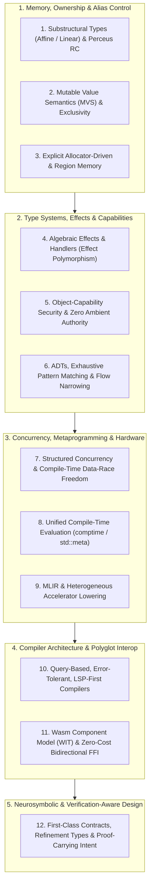

# State-of-the-Art (SOTA) Research: Defining Features & Traits of Modern Programming Languages (2025–2026) and Gap Evaluation for Bash# (`bashsharp`)

*Tool / Author: `agy` (Google Antigravity)*
*Status: External SOTA research + codebase gap evaluation (`bashsharp`, `sh`, `bashy`). Tracked under Sprint #609 / Story `d849e6cc2dc9`.*

---

# Part I: External SOTA Survey — The 12 Defining Traits of Modern Programming Languages (2025–2026)

## Executive Summary

Across modern programming language theory (POPL, PLDI, OOPSLA) and recent industry designs (**Rust**, **Zig**, **Swift 6**, **C++26**, **Mojo**, **Koka**, **OCaml 5**, **Hylo**, **Austral**, **Vale**, **Roc**, **Gleam**, **MoonBit**, **Verse**, **Verus**, **Dafny**, **Lean 4**, **Unison**), contemporary language design has converged on four core shifts:

1. **Shift invariants to compile time without runtime tax:** Memory lifetimes, aliasing exclusivity, thread-safety/data-race freedom, protocol state transitions, and null/error handling are verified statically rather than left to garbage collectors or runtime exceptions.
2. **Make all side effects and capabilities explicit:** Instead of ambient OS authority and hidden control flow, functions declare or receive their effects (`IO`, `Async`, `Exn`, `Yield`, `NonDet`) and capabilities explicitly.
3. **Unify high-level ergonomics with systems/accelerator performance:** Through Perceus static reference-counting reuse, Mutable Value Semantics (MVS), `comptime` evaluation, and MLIR lowering, modern languages avoid forcing a split between "productivity scripting" and "systems code."
4. **Design for two non-traditional consumers—LSP servers and neuro-formal verifiers:** Compilers are built as demand-driven, error-tolerant query databases (`Salsa`-style), and languages embed machine-checkable specifications (`requires`/`ensures`, refinement types) so AI-generated code can be verified deterministically by SMT solvers or proof assistants rather than judged by another LLM.

---

## Architecture Overview: The 12 SOTA Traits Across 5 Domains

---

## Domain 1: Memory Management, Ownership & Aliasing Control

The classic dichotomy between **manual `malloc`/`free`** (unsafe) and **tracing Garbage Collection** (non-deterministic pause times, high memory footprint, heavyweight runtime for FFI/Wasm) has been superseded by four modern approaches:

### 1. Substructural Type Systems (Affine & Linear Types) and Perceus Reference Counting
* **Affine Types (use *at most* once):** Mainstreamed by **Rust** and adopted in **Mojo**. Values have a single owner; assignment moves ownership, and borrowing enforces compile-time *aliasing XOR mutability* (`&T` vs. `&mut T`).
* **Strict Linear Types (use *exactly* once):** Championed by **Austral** and **Granule** (via graded modal types). Unlike affine types—where a value can be implicitly dropped at scope exit—a linear value *cannot* be silently dropped. It must be explicitly consumed by a destructor/transition function. This turns resource leaks, uncommitted database transactions, unclosed file descriptors, and unhandled obligations into compile-time type errors.
* **Compile-Time Optimized Reference Counting (*Perceus* & Reuse Analysis):** Pioneered by **Koka** and **Lean 4**, and used in **Roc**. Instead of a tracing GC or lifetime annotations, the compiler inserts precise reference counts and performs **static reuse analysis**: when a function pattern-matches a constructor whose runtime/static reference count is `1` and constructs a node of the same size, the compiler compiles the functional update into an **in-place destructive mutation**—matching imperative C/Rust performance in a purely functional language.

### 2. Mutable Value Semantics (MVS) & the Law of Exclusivity
* **The Problem:** Reference semantics (Java, Python, JavaScript, C++) allow "spooky action at a distance" through shared mutable aliases, destroying local reasoning. Conversely, Rust's reference lifetimes (`'a`) introduce syntactic and viral signature complexity.
* **The SOTA Solution (**Hylo** [formerly Val], **Swift**):** Every variable logically holds an independent value—shared mutable references do not exist in the safe language. To avoid copying large structures, parameters and projections (`inout`, `set`, `let`, and `subscript` projections in Hylo) operate as **borrowed in-place views** governed by the *Law of Exclusivity*. Hylo demonstrates that systems-level zero-copy mutation and memory safety can be achieved **without lifetime annotations or garbage collection**.

### 3. Explicit Allocator Passing & Region/Generational Memory
* **Explicit Allocators (**Zig**, **Odin**):** No hidden heap allocations in the standard library. Every allocating API accepts an explicit `Allocator` parameter, making out-of-memory handling explicit and allowing callers to swap in arena allocators, stack/fixed-buffer allocators, or deterministic leak-detecting test allocators with one line of code.
* **Generational References & Regions (**Vale**):** Replaces lifetime annotations with deterministic single ownership plus lightweight generation counters on references (or opt-in region borrow checking), turning use-after-free into deterministic checks without tracing GC pauses.

---

## Domain 2: Type Systems, Effects & Capabilities

### 4. Algebraic Effects & Handlers (Eliminating "Function Coloring")
* **The Problem:** Traditional languages fracture ecosystems by "coloring" functions: `sync` vs. `async`, throwing vs. non-throwing, generator (`yield`) vs. ordinary return, pure vs. impure.
* **The SOTA Solution (**Koka**, **OCaml 5**, **Effekt**, **Ante**, **Unison**):** Side effects (`IO`, `Async`, `Exn`, `Yield`, `State`, `NonDet`, `Log`) are modeled as **algebraic effects** tracked in effect rows on function types and interpreted dynamically up the call stack by **effect handlers** (delimited continuations).
  * **Effect Polymorphism:** Higher-order functions (`map`, `filter`, `fold`) are automatically polymorphic over the effect row of the callback passed to them—eliminating duplicate `map` / `asyncMap` / `tryMap` APIs.
  * **Swappable Semantics:** The same business logic can be run under a production async I/O handler, a deterministic in-memory mock handler for testing, or a replay/tracing handler without modifying the function or relying on global dependency-injection frameworks.
  * **Affine One-Shot Effects (*Affect*, POPL 2025):** Combines affine types with algebraic effects to statically guarantee that continuations are resumed at most once when mutable references are live, enabling zero-cost stack-switching fibers.

### 5. Object-Capability Security & Zero Ambient Authority
* **The Problem:** In POSIX-era languages, any imported helper library inherits the entire process's ambient authority to read `~/.ssh`, open network sockets, read environment variables, or spawn child processes (the *Confused Deputy* and supply-chain attack problem).
* **The SOTA Solution (**Austral**, **Wyvern**, **Monte/E**, **Dafny**, **WASI Preview 2/3**):** Code starts with **zero ambient authority**. System resources (`FileSystem`, `Net`, `Clock`, `Process`, `Random`) can only be accessed via unforgeable capability tokens passed down from `main` (or bounded context parameters). A reviewer or static analyzer can determine the exact security perimeter of a third-party package solely from its function signatures.

### 6. Algebraic Data Types (ADTs), Exhaustive Pattern Matching & Flow-Sensitive Narrowing
* **Sum + Product Types:** Tagged unions (`enum` with payloads in **Rust**, **Swift**, **Gleam**, **MoonBit**) paired with exhaustive `match` expressions make illegal states unrepresentable.
* **Values over Nulls & Exceptions:** `Option<T>` and `Result<T, E>` (with ergonomic propagation `?` and pattern-binding `let Ok(x) = ... else { ... }`) replace null pointers and unchecked exceptions.
* **Flow-Sensitive & Set-Theoretic Typing (**TypeScript**, **Kotlin 2**, **Elixir 1.17+ gradual set-theoretic types**):** The compiler tracks control-flow predicates (`if`, `match`, `assert`) to refine union and nullable types automatically without casts.

---

## Domain 3: Concurrency, Metaprogramming & Hardware Lowering

### 7. Structured Concurrency & Compile-Time Data-Race Freedom
* **Structured Concurrency (**Swift 6**, **Kotlin Coroutines**, **Java 21–24 Loom `StructuredTaskScope`**, **C++26 `std::execution` P2300**):** Concurrent work is bound to a lexical scope. Child tasks cannot outlive the scope that spawned them, cancellation cascades downward automatically, and unhandled errors cancel sibling tasks and propagate upward deterministically.
* **Compile-Time Data-Race Safety (**Swift 6**, **Rust**):** Swift 6 elevates data-race safety to a default compile-time guarantee via `Sendable` checking, actor isolation, and **region-based isolation** (`sending` parameters that prove a mutable non-`Sendable` graph is transferred across concurrency domains with no remaining aliases).

### 8. Unified Compile-Time Evaluation (`comptime` & Static Reflection)
* **Replacing Preprocessors and Separate Macro Languages:** Instead of textual preprocessors (`#define`), fragile build-time code generators, or slow runtime reflection, modern languages execute **ordinary language syntax at compile time**.
* **Zig `comptime`:** Types are first-class values at compile time; generic data structures are simply ordinary functions that take a `type` parameter at `comptime` and return a struct `type`.
* **C++26 Static Reflection (`std::meta` / P2996):** Introduces reflection values (`^^T`), compile-time meta-functions (`std::meta::members_of`), and splicers (`[: :]`), allowing serializers, CLI parsers, RPC stubs, and mock objects to be synthesized in standard code at compile time with zero runtime overhead.

### 9. MLIR-Native & Heterogeneous Accelerator Lowering
* **First-Class Heterogeneous Compute (**Mojo**, **Triton**, **Julia**, **Bend**):** Modern compute is no longer CPU-only. Languages built directly on **MLIR (Multi-Level Intermediate Representation)** (such as **Mojo**) expose SIMD width parameterization, autotuning, tensor tiling, and GPU/TPU/NPU kernel lowering inside the host language rather than forcing developers across a Python-to-C++/CUDA cliff.

---

## Domain 4: Compiler Architecture, Tooling & Polyglot Interop

### 10. Query-Based, Error-Tolerant, LSP-First Compiler Architecture
* **Demand-Driven Incremental Databases (**Salsa** / `rust-analyzer`, **Roslyn**, **MoonBit**, **Swift**):** Instead of a monolithic batch pipeline (`lex -> parse -> typecheck -> codegen`), modern compilers are architected as reactive, memoized query databases. Editing a single line invalidates only the fine-grained function-body query while reusing workspace-wide type and symbol tables.
* **Resilient / Error-Tolerant Parsing & Typed Holes:** Because source code inside an IDE—or mid-stream from an LLM agent—is syntactically incomplete most of the time, SOTA parsers build lossless Concrete Syntax Trees (CSTs) with error recovery nodes and support **typed holes** (`_` / `?`), allowing type inference, diagnostics, and completions to work continuously on broken code.
* **Batteries-Included Single-Binary Toolchain (**Deno**, **Bun**, **Go**, **Gleam**, **MoonBit**, **Uv/Ruff**):** Compiler, package manager, cryptographic lockfile, formatter, linter, test runner, and doc generator ship as one unified, zero-config CLI with sub-second incremental feedback loops.

### 11. WebAssembly Component Model (WIT) & Zero-Cost Bidirectional FFI
* **Language-Neutral High-Level ABI (**Wasm Component Model** & **WIT**):** Rather than dropping down to unsafe C pointers (`extern "C"`) for cross-language calls, **WIT (WebAssembly Interface Types)** defines rich typed interfaces (records, variants, lists, strings, capability resources) with a shared-nothing canonical ABI. Polyglot components written in Rust, Go, Python, C++, or MoonBit compose with fine-grained sandboxing and static capability inspection (`world` imports/exports).
* **Frictionless Native Interop:** **Zig** directly parses C headers (`@cImport`) and cross-compiles C/C++ out of the box without bindings; **Carbon** and **Cpp2** provide bidirectional ABI/AST interop with C++; **Mojo** provides zero-wrapper Python ecosystem interop.

---

## Domain 5: Neurosymbolic & Verification-Aware Design (The AI Agent Era)

As autonomous AI coding agents write, refactor, and execute larger volumes of software, 2025–2026 PL research has converged on specific design traits that bridge **probabilistic neural generation** and **deterministic software assurance**:

### 12. First-Class Contracts, Refinement Types & Neuro-Formal Verification
* **Integrated Pre/Post-Conditions & Refinement Types (**Dafny**, **Verus**, **F\***, **Liquid Haskell**, **Flux for Rust**, **Spark Ada**, **C++26 Contracts P2900**):** Specifications (`requires`, `ensures`, `invariant`, `decreases`) and refinement predicates (`{x: i32 | x > 0}`) are first-class syntax verified statically via SMT solvers (Z3, CVC5) or runtime/compile-time guards.
* **The "Agentic Mullet" Pattern (*Code in the Front, Proofs in the Back*):** Recent neurosymbolic systems (**Verus / Microsoft PDD Kit**, **AutoVerus**, **AlphaProof / Lean 4**, **AutoRocq**, **DARPA GUMBO/HAMR**) separate fast feature code from formal contracts. An LLM agent generates or edits the implementation, and a deterministic verifier checks the contract/proof—solving the trust gap without relying on an LLM to judge its own code.
* **LLM-Optimal Language Topology (Locality, Low Perplexity & Content Addressing):**
  * **Strict Local Reasoning:** When a function's signature completely specifies its types, error cases, mutability (`inout` / `&mut`), and side effects/capabilities—with no implicit global state, monkey-patching, or ambient authority—both a human reviewer and a bounded-context LLM agent can reason about a 50-line function in isolation without loading a 500,000-line codebase into context.
  * **Functional-Logic Unification & Determinism (**Verse**):** Epic Games' **Verse** introduces functional-logic semantics (lenient evaluation, first-class failure/choice expressions in `decides` effect contexts, speculative transactional rollback on failure) designed so concurrent multi-author and agent scripts compose deterministically without race conditions.
  * **Content-Addressed Code (**Unison**):** Indexing definitions by the cryptographic hash of their normalized AST rather than mutable text files eliminates dependency hell, broken builds during multi-agent concurrent edits, and serialization boilerplate for distributed execution.

---

# Part II: Codebase & Architecture Gap Evaluation for Bash# (`bashsharp` / `sh` / `bashy`)

This section evaluates the actual implementation across `bashsharp/`, `sh/`, and `bashy/` against the 12 SOTA traits above—separating **where Bash# is already at or ahead of SOTA**, **where deliberate architectural trade-offs were made** (the 4-part admissibility test in `bashsharp/docs/bashsharp-ergonomics-tier.md`), and **the concrete engineering gaps that remain in the codebase today**.

## Summary Scorecard: SOTA vs. Current Bash# Implementation

| SOTA Domain & Trait | Bash# Status | Key Implementation Seams Inspected | Primary Gap Class |
|---|---|---|---|
| **1. Substructural / Ownership & Bridge Lifetimes** | **Partial (Runtime Leases; Origin/Closure Leaks Open)** | `sh/docs/s374-ownership.md`, `sh/docs/s374-ownership-result.md` | **Concrete Engineering Gap (G1)** |
| **2. Mutable Value Semantics & Deep Immutability** | **Partial (Runtime `readonly`; Missing Snapshot Remap)** | `sh/expand/environ.go:98-100`, `sh/lower/shellrt/readonly.go`, `sh/interp/bashpp_readonly.go` | **Concrete Engineering Gap (G2)** |
| **3. Interpreter Memory / Per-Call Allocation** | **Gap (2.72 KB / 48.5 allocs per call; 14.5 KiB stack)** | `sh/docs/bashpp-interpreter-per-call-cost.md`, `bashsharp/docs/interpreted-performance-v1.md` | **Concrete Engineering Gap (G3)** |
| **4. Algebraic Effects, `agentic` & Yield (`exit 6`)** | **Strong (Runtime Dynamic Chain; No Static Effect Typing)** | `sh/interp/bashpp_decorator.go`, `bashy/internal/agentos/decorators.go`, `bashy/internal/agentos/confirm.go` | **Static-vs-Dynamic Gap (G4)** |
| **5. Capability Security & Containment** | **Partial (Shell-Side Guarded; Fence Process Spawns Escape)** | `bashy/internal/agentos/contain.go`, `bashy/internal/agentos/limit.go`, `docs/research-xonsh-python-fence.md` | **Critical Boundary Gap (G5 — Sprint #600)** |
| **6. ADTs, Exhaustive Enums & Flow Narrowing** | **Partial (C-Style `iota` Enums; Bounded Null Checker)** | `sh/lower/bashsharp.go:110-238`, `sh/docs/lowering-bashsharp.md` | **Concrete Engineering Gap (G6)** |
| **7. Structured Concurrency & Data-Race Safety** | **Mixed (Host `RWMutex` Guard; Mixed Snapshot Asymmetry)** | `sh/interp/bashpp_concurrency.go`, `sh/interp/bashpp_cell_share.go`, `sh/interp/bashpp_stream_group.go` | **Semantic Asymmetry Gap (G7)** |
| **8. Metaprogramming (`@decorator` & Advice)** | **Shipped (Runtime `*Call` + Registration Advice)** | `bashsharp/docs/bashpp-decorators-and-advice.md`, `sh/lower/callables_decorators.go` | **Deliberate Trade-off (Go Lowering Constraint)** |
| **9. Mixed Grammar & Go Construct Completeness** | **4 Named Mixed Gaps (`M09`–`M12`) + `maxLookahead=64`** | `bashsharp/docs/go-delta.md`, `sh/syntax/bashpp_startsites.go:45-55` | **Concrete Parser/Evaluator Gap (G8)** |
| **10. Compiler Architecture, Seams & LSP/Check** | **Partial (140 `bashpp_*.go` coupled in `sh/interp`)** | `bashsharp/CLAUDE.md:58-95`, `bashsharp/front/check.go`, `bashy/internal/agentos/check.go` | **Architectural Seam Gap (G9)** |
| **11. Polyglot Fences & Cross-Boundary Types** | **Partial (NDJSON String/Scalar Bridge; Per-Call Go/C Spawn)** | `sh/polyglot/polyglot.go`, `sh/docs/bashpp-polyglot-fences.md` | **Concrete Interop Gap (G10)** |
| **12. Neurosymbolic Contracts & Empirical Agent Efficacy** | **Strong Primitives; Shell-String Checks Only (`@require`/`@ensure`)** | `bashy/internal/agentos/contracts.go`, `bashy/internal/agentos/attest.go`, `bashsharp/docs/bashsharp-for-agents.md` | **Static Verification & UX Gap (G11)** |

---

## Detailed Gap Analysis (Code-Level Findings)

### Gap G1: Cross-Bridge Ownership — Pointer Origins and Closure Tables Still Leak (`sh/interp`)
* **SOTA Reference:** Substructural/affine ownership and deterministic resource reclamation (Domain 1, Trait 1).
* **Code & Doc Evidence:**
  * In `sh/docs/s374-ownership.md` and `sh/docs/s374-ownership-result.md`, Sprint 374 implemented lease-based reclamation for transient worker handles (`encodeHandle` leases drained on the next request).
  * However, **pointer origins** (which denote two physical copies—interpreter and native worker—of one logical object) and **string-backed closure registrations** remain unreclaimed (`rangegen` grows `8 -> 16` origins and `784 -> 1,568` closures; `issue15277` fails its memory drop threshold).
  * Three candidate fixes (cell cleanups, weak pointer wrappers, and call-scoped origin removal) failed because both tables root the cell or split pointer identity across calls.
* **The Gap:** Long-running persistent `bashy` / Bash# sessions that repeatedly pass pointers or closures across the native package bridge accumulate permanent origin, pinned-slice, and closure-table entries. Closing this requires a coordinated two-sided epoch/safepoint protocol or explicit retention-edge tracking across the reflection bridge.

---

### Gap G2: Mutable Value Semantics vs. Shared `Variable.Obj` and Incomplete `readonly` Lowering
* **SOTA Reference:** Mutable Value Semantics (Hylo/Swift) and Perceus copy-on-write/in-place mutation (Domain 1, Trait 2).
* **Code & Doc Evidence:**
  * `sh/expand/environ.go:98-100` explicitly notes: *"Note that Obj is not deep-copied when a Variable is copied, so an object is shared, not snapshotted, by an assignment or a subshell."*
  * To mitigate this, Bash# added deep `readonly` (`sh/interp/bashpp_readonly.go` and `sh/lower/shellrt/readonly.go`).
  * However, inspecting `sh/lower/shellrt/readonly.go:66` and `sh/docs/lowering-bashsharp.md:85-94,130-131` reveals three concrete gaps:
    1. `ReadonlyState.Mark` appends every frozen binding to `s.retained = append(s.retained, binding)` (`sh/lower/shellrt/readonly.go:66`) to keep pointer addresses stable, which **permanently pins every `readonly` object in memory for the life of the program/session**.
    2. Subshell and task snapshots that clone native values **do not yet remap `ReadonlyState` identity** to the cloned addresses (`sh/docs/lowering-bashsharp.md:87-91`).
    3. Zero-size slice-element identity and full compiled-artifact execution for the seven `readonly` negative cases remain unfinished integration slices (`sh/docs/lowering-bashsharp.md:91-93,130-131`).

---

### Gap G3: Tree-Walking Interpreter Overhead & Recursive Go Stack Exhaustion (`sh/interp`)
* **SOTA Reference:** Bytecode/register VMs, JITs, and zero-allocation scalar fast paths (Domain 1 & Domain 3).
* **Code & Doc Evidence:**
  * `sh/docs/bashpp-interpreter-per-call-cost.md` and `bashsharp/docs/interpreted-performance-v1.md` measure the exact cost of the current AST-walking evaluator:
    * Each logical interpreted function call costs **~2.37 µs**, allocates **2.72 KB across 48.5 heap allocations** (55–63% copying/boxing `bashPPCell` values, 25% constructing `bashPPFrame`/`overlayEnviron`/`bashPPScope` maps), and consumes **~14.5 KiB of host Go stack per recursion level** (`Runner.cmd` + `Runner.stmtSync`).
    * As a result, CPU-bound workloads like `abi/uglyfib.go` take **2,232.9 seconds (~37 minutes)** interpreted vs. **1.06 seconds** compiled (`bashsharp/docs/interpreted-performance-v1.md:25`), and 11 compute-bound roots in the Go corpus fail the 60-second gate (`bashsharp/docs/claims.md:94`).
* **The Gap:** Frame pooling (<1.4×) and slice-indexed locals (1.05–1.2×) are insufficient on their own. Closing the 100×–2,000× interpreted scalar performance gap and fixing the 14.5 KiB/frame recursion stack limit requires a **non-recursive, flat-frame scalar bytecode/instruction evaluator** (`bashpp_scalarcode.go`, tracked post-v1.0 under Sprint 380).

---

### Gap G4: Dynamic vs. Static Effect & `agentic` Verification (`sh/interp`, `sh/lower`, `bashy/internal/agentos`)
* **SOTA Reference:** Algebraic Effect Handlers (Koka, OCaml 5) and Static Capability/Effect Checking (Domain 2, Trait 4).
* **Where Bash# Excels:**
  * Bash# has a remarkably practical *runtime* algebraic-effect handler analogue:
    * `agentic` scope tracking (`sh/interp/bashpp_agentic.go`),
    * First-class yield semantics via exit status `6` (`ExitInputRequired`) with approval tokens and `--confirm=TOKEN:yes` resumption (`bashy/internal/agentos/confirm.go`),
    * Composable `*Call` continuation chains (`c.Next(ctx)`) for `@trace`, `@guard`, `@effects`, `@retry`, `@timeout`, `@memo`, `@auth`, `@confirm`, `@contain`, `@limit`, and `@attest` (`bashy/internal/agentos/decorators.go`).
* **The Gap:**
  1. **Call-Time vs. Check-Time Resolution:** Both `agentic` scope violations (calling an `agentic func` outside `agentic { }`) and `@effects` vs. `@guard` cap mismatches are checked **dynamically when the call is reached at runtime** (`bashsharp/docs/bashpp-agentic-mvp-plan.md:91-103`, `bashy/internal/agentos/decorators_std.go:265-272`), rather than statically during `bashy check --bashsharp`. If an unguarded call to an `agentic func` sits in an error branch that is not taken during a test run, it is not caught until production execution.
  2. **Decorated Shell Functions Cannot Be Lowered:** As noted in `bashsharp/docs/bashpp-decorators-and-advice.md:301-302` and `sh/polyglot/polyglot.go`, decorated classic shell functions and `"agentic": true` foreign text-fence methods are refused by `transpile` lowering.
  3. **Compiled Host Has No Policy Advice Slot:** In `bashy/internal/agentos/decorators.go:148-150`, the compiled `shellrt` host has no registration-time `Advice` slot (`lower.Options.Advice` is post-MVP), meaning `BASHY_ADVICE` policy rules and automatic `agentic` attestation (`bashy:attest`) only fire on compiled functions if they already carry an explicit source decorator.

---

### Gap G5: Capability Containment Bypass in Fenced Polyglot Workers (`sh/polyglot` — Sprint #600)
* **SOTA Reference:** Object-Capability Security & WASI Preview 2/3 Zero Ambient Authority (Domain 2, Trait 5).
* **Code & Doc Evidence:**
  * On the shell side, `bashy` routes external commands through `wireExec` middleware (`audit` -> `weaveGuard` -> `hostFloorHandler` -> `containHandler` -> `limitHandler` -> coreutils/registered commands).
  * However, as documented in `docs/research-xonsh-python-fence.md:58-64` and `sh/docs/bashpp-polyglot-fences.md:100-102`, **fenced polyglot code (`~~~python`, `~~~ts`, `~~~rust`, `~~~go`, `~~~c`, `~~~csharp`, `~~~pwsh`) is currently an escape hatch from `bashy`'s guardrails**:
    1. **Subprocess Bypass:** When fenced code calls `subprocess.Popen`, `os.system`, `child_process.spawn`, `std::process::Command`, or `exec.Command`, it invokes the OS directly—completely bypassing `@guard(effects: ...)`, `@contain(net: "deny")`, `@confirm()`, the command registry, and `bashy`'s pure-Go POSIX coreutils (breaking Windows portability for POSIX commands called from inside fences).
    2. **Stale Worker Environment:** Persistent workers (`python`, `ts`, `rust`, `pwsh`) capture `cmd.Env` once when the worker process launches. Subsequent `export VAR=val` statements in the script do **not** propagate to subsequent fence calls (`docs/research-xonsh-python-fence.md:142-158`).
    3. **Incomplete Job-Group Lifecycle in TS/JS:** While Python, Rust, C#, and PowerShell workers implement `job_join`/`job_leave` (`sh/polyglot/process_group.go`), the TypeScript/JavaScript worker does not yet join the pipeline process group (`docs/research-xonsh-python-fence.md:104-109`).
  * *(Note: This exact gap cluster is filed as Sprint #600 / stories `S600.1`–`S600.7` in the umbrella backlog.)*

---

### Gap G6: Enum Expressiveness & Bounded Static Null-Flow Analysis (`sh/lower/bashsharp.go`)
* **SOTA Reference:** Tagged-Union ADTs (`Option`/`Result`), Exhaustive Pattern Matching, and Sound Flow-Sensitive Typing (Domain 2, Trait 6).
* **Code & Doc Evidence:**
  * Inspecting `sh/lower/bashsharp.go:110-238` and `sh/lower/bashsharp.go:388-698` shows how `CheckBashSharp` implements enums and null-safety:
    1. **Enums are Flat Integer Constants Only:** `enumDecl` lowers `type Color enum { Red; Green }` to `type Color int; const (Red Color = 0; ...)` (`sh/lower/bashsharp.go:123-134`). Because Go lacks sum types, Bash# enums cannot carry variant payloads (unlike Rust/Swift/Gleam ADTs).
    2. **Narrow Exhaustiveness Trigger:** In `sh/lower/bashsharp.go:186-226`, enum switch exhaustiveness (`BASHPP-EENUM-NONEXHAUSTIVE`) only triggers inside a `BashPPFuncDecl` when the `switch` tag is a bare identifier (`*syntax.BashPPIdent`) whose type matches a function **parameter** in `node.Params`. Switches at the top level of a script, switches on a local variable `x := Red`, or switches on a struct field/call expression `switch obj.Color` are **not** checked for exhaustiveness!
    3. **Non-Constant Enum Conversion Guard Missing:** As documented in `sh/docs/lowering-bashsharp.md:22-23,119-120`, literal out-of-range conversions `Color(99)` are caught statically (`BASHPP-EENUM-VALUE`), but dynamic conversions `Color(n)` remain unsupported until runtime membership guards are emitted.
    4. **Bounded Intraprocedural Null Checker:** In `sh/lower/bashsharp.go:412-698`, `sharpNullChecker` only seeds nullability from **function parameters** (`c.parameters(node.Params)`) and direct aliases of those parameters inside `BashPPFuncDecl` bodies. It does not check top-level script statements outside `func`, does not track nullable return values from function calls, does not track struct field dereferences (`p.field` is parsed as `op = "selector"`, whereas `check()` only checks `op == "deref"`, `"index"`, `"call"` at lines 472–481!), and does not invalidate narrowing across closures or shell command side effects.

---

### Gap G7: Concurrency Model Asymmetry & Unstructured Goroutines (`sh/interp`)
* **SOTA Reference:** Structured Concurrency (`StructuredTaskScope` / TaskGroups) & Compile-Time Data-Race Freedom (Swift 6 `Sendable` / Rust) (Domain 3, Trait 7).
* **Code & Doc Evidence:**
  * **Where Bash# is Strong:** Pipeline stream jobs (`sh/interp/bashpp_stream_group.go`) use deterministic pointer-sorted module reservation, process-group joining, and fail-closed worker teardown—true structured concurrency for shell pipelines. And `sh/interp/bashpp_cell_share.go` uses a clever per-cell `sync.RWMutex` (`shareGuard`, `view`, `publish`) with AST scan ratchets (`TestBashPPCellReadersTakeAView`) so guest data races cannot tear host Go strings/interfaces.
  * **The Gaps:**
    1. **Semantic Split Between Mixed Mode (`M08`) and Unit/Compiled Mode:** As recorded in `bashsharp/docs/go-delta.md` row `M08`, a goroutine launched in **mixed** script text receives a *snapshot* of ordinary Go bindings (so writes inside `go func() { x = 9 }()` vanish), whereas the exact same goroutine in a **package-led Go unit (`U01`)** or **transpiled (`bashy transpile`)** shares the variable by reference and mutates `x = 9`. This violates the "interpreted == compiled" equivalence principle for mixed-mode goroutines.
    2. **No Guest Data-Race Diagnostics:** `shareGuard` protects the *host interpreter* from crashing on torn Go memory when two guest goroutines race on a variable, but the guest race itself is silent (neither statically rejected like Swift 6/Rust nor flagged by a guest race detector in interpreted mode).
    3. **Unstructured `go` Statements:** Like Go itself, `go fn()` spawns an unscoped background goroutine rather than a lexically scoped task group, meaning background goroutines in a script function can outlive the function call and its `@guard` / `@timeout` decorator frame unless manually synchronized via channels or `sync.WaitGroup`.

---

### Gap G8: Parser Streaming Lookahead Ceiling (`maxLookahead = 64`) & The 4 Mixed Go Gaps (`M09`–`M12`)
* **SOTA Reference:** Unified Dual-Syntax / Superset Ergonomics (Mojo) & Spec Completeness (Domain 1 & Domain 4).
* **Code & Doc Evidence:**
  * `sh/syntax/bashpp_startsites.go:30-55` explains a fundamental architectural constraint: `sh`'s parser is streaming and non-backtracking across chunk boundaries, so `RecognizeStartSite` truncates lookahead to `const maxLookahead = 64` bytes.
  * Directly because of this and mixed-mode evaluation rules, `bashsharp/docs/go-delta.md` documents four user-facing gaps in mixed scripts:
    * **`M09` (Top-level Go `if`/`for` blocks between shell commands):** Rejected because a shell `if` can legally carry `{` in its condition before `then` past 64 bytes (`StartGoIf` is unbounded in a non-backtracking streaming parser).
    * **`M10` (`for ... := range` inside a mixed-text `func` body):** Fails with `for condition must be a scalar expression` (only counted `for i := 0; i < n; i++` works in mixed `func` bodies today).
    * **`M11` (Generic type constraint unions `int | float64`):** Fails in mixed mode because `|` is lexed as a shell pipe token (`syntax error near unexpected token 'float64]'`).
    * **`M12` (Selector expression `return j.ID` on a struct value in mixed mode):** Returns the literal selector text `"j.ID"` instead of the field value—explicitly flagged in `go-delta.md` as a defect.
  * Additional open syntax items in `bashsharp/ROADMAP.md:13`: a function call in keyword-argument position (`f(k: g(x))`) and negative numeric literals as call arguments.

---

### Gap G9: Engine Modularity Seam (`sh/interp`) and Batch-Only Static Checking (No Incremental LSP)
* **SOTA Reference:** Query-Based, Error-Tolerant, LSP-First Compilers (`Salsa` / `rust-analyzer`) & Modular Compiler Layers (Domain 4, Trait 10).
* **Code & Doc Evidence:**
  * **Tight Engine Coupling (`docs/seam.md` / `bashsharp/CLAUDE.md`):** As documented in `bashsharp/CLAUDE.md:58-95` and tracked by Sprint 575/581 (`todo:0ad75a11`, `todo:68dba07e`), the Bash# evaluator (`140` `bashpp_*.go` and `gosource_*.go` files) still lives inside `sh/interp` and touches 71 unexported `Runner` fields and 73 methods.
  * **No Incremental Query Engine or LSP Server:** `bashy check` (`bashy/internal/agentos/check.go`) and `bashsharp --check` (`bashsharp/front/check.go`) are batch single-pass tools. There is no `bashy lsp` (Language Server Protocol) server, no error-tolerant CST recovery for broken in-editor code, and `CheckBashSharp` only runs a narrow set of checks (kwargs, defaults, enum literals, parameter switches, parameter null-flow) rather than full static type-checking of mixed Go expressions before execution.

---

### Gap G10: Polyglot Bridge Overhead, JSON Value Serialization & Per-Call Process Spawns (`sh/polyglot`)
* **SOTA Reference:** Zero-Cost FFI, Wasm Component Model (WIT), and Shared-Memory/Zero-Copy Bridges (Domain 4, Trait 11).
* **Code & Doc Evidence:**
  * Inspecting `sh/polyglot/polyglot.go` and `sh/docs/bashpp-polyglot-fences.md`:
    1. **Fresh Worker Process Per Call for C, C++, and Go Fences:** While Python, TypeScript, Rust, and PowerShell use one persistent worker per module, **C, C++, and Go fences launch a brand-new OS process on every single function call** (`sh/docs/bashpp-polyglot-fences.md:138,217`: *"Each call launches a fresh worker, exchanges one JSON request/result frame"*). Calling a fenced C or Go function inside a 1,000-iteration loop spawns 1,000 OS processes.
    2. **Non-Scalar Values Cross as JSON Strings / Opaque Handles:** Lists, dicts, and structs crossing between shell/Go and fenced languages are serialized to JSON over newline-delimited pipes (`serde_json`, `json.dumps`) rather than zero-copy shared memory or canonical binary ABI (WIT), and returned lists arrive in shell as JSON strings (`bashsharp/docs/why-bashsharp.md:140-142`).
    3. **Standalone Transpilation Still Requires Guest Runtimes for Interpreted Fences:** Lowering a `.bsh` file with `~~~python`, `~~~ts`, `~~~powershell`, or `~~~csharp` embeds the source plan, not a compiled binary—so the target machine still requires Python, Node, or PowerShell 7 at runtime (`sh/docs/bashpp-polyglot-fences.md:258-261,301-305`).

---

### Gap G11: Dynamic Shell-String Contracts vs. Static Neuro-Formal Verification (`bashy/internal/agentos/contracts.go`)
* **SOTA Reference:** SMT-Backed Refinement Types / Contracts (Verus, Dafny) & Empirical Agent Ergonomics (Domain 5, Trait 12).
* **Code & Doc Evidence:**
  * **Contract Representation:** In `bashy/internal/agentos/contracts.go`, `@require("...")` and `@ensure("...")` evaluate arbitrary **shell command strings at runtime** via `c.Run(ctx, check, vars)` (spawning a fresh `syntax.NewParser()` on every check invocation at `sh/interp/bashpp_decorator.go:84-88`, and passing only the first return value of a typed function as the string `$RESULT` at `bashy/internal/agentos/contracts.go:129-131`).
  * **Gaps:**
    1. **No Static Discharge or Type-Safe Predicates:** Because contracts are opaque shell strings (`@require('test -n "$1"')`), `bashy check` cannot statically verify whether a caller satisfies `@require` at compile time, nor can `@ensure` directly inspect structured typed Go return values beyond `fmt.Sprint(c.Results[0])` (or multiple return values `Results[1]`, error values, etc.).
    2. **Re-Parsing Contract Strings on Every Call:** `Call.Run` (`sh/interp/bashpp_decorator.go:84-88`) instantiates a new `syntax.NewParser()` and reparses the contract string on every single call to a contracted function instead of caching the parsed `*syntax.File` per decorator site.
    3. **Agent Ergonomics & Effect-Configuration Friction:** As candidly documented in `bashsharp/docs/bashsharp-for-agents.md:83-170`, the initial paired L2 benchmark (`sprint-381`) saw `@guard(effects: "read,write,exec")` drop agent solve rates from `59/60` (98.3%) to `13/60` (21.7%) because nested shell invocations hit unknown-command effect denials; adding `@effects("read,write,exec")` (`sprint-287`) restored parity (`59/60`), proving that capability/effect ergonomics must be frictionless and statically explainable (`bashy check` preflight) or they actively hurt agent task completion.

---

## Prioritized Recommendations for Bash# Based on SOTA Findings

1. **Close the Polyglot Capability & Environment Escape Hatch (Sprint #600 / Gap G5):**
   - Route all fenced worker process spawns (`python`, `ts`, `rust`, `go`, `c`, `cpp`, `csharp`, `pwsh`) through `bashy` so `@guard`, `@contain`, `@limit`, `@confirm`, and the command registry cannot be bypassed from inside a fence, and propagate exported environment deltas per call.
2. **Fix the 4 Mixed-Mode Go Delta Gaps & Broaden `CheckBashSharp` (Gaps G6, G8, G4):**
   - Repair `M10` (`range` in mixed `func`), `M11` (union type constraints `int | float64`), and `M12` (struct selector return defect).
   - Extend `CheckBashSharp` in `sh/lower/bashsharp.go` to:
     - Check enum `switch` exhaustiveness on local variables and expressions (not just function parameters),
     - Check `p.field` selector dereferences (`op == "selector"`) in `sharpNullChecker`,
     - Statically flag unguarded calls to `agentic func` outside `agentic { }` and static `@effects` vs. `@guard` violations during `bashy check --bashsharp`.
3. **Unify Mixed-Mode vs. Compiled Goroutine Semantics (`M08` / Gap G7):**
   - Align mixed-mode `go func()` variable capture with `bashpp_cell_share.go` (or warn statically in `bashy check` when a mixed-mode goroutine mutates a captured outer binding whose write will be discarded in interpreted mode but retained in compiled mode).
4. **Cache Parsed Contract ASTs & Expose Multi-Result Bindings in `@ensure` (Gap G11):**
   - Cache the parsed `*syntax.File` in `Call.Run` (`sh/interp/bashpp_decorator.go:79`) and bind `$RESULT_0`, `$RESULT_1`, ... (plus `$ERR`) in `@ensure` (`bashy/internal/agentos/contracts.go:128`) so contracts on `(T, error)` functions can inspect both the value and the error.
5. **Convert C/C++/Go Fences to Persistent Workers & Add Non-Recursive Scalar Bytecode (Gaps G3, G10):**
   - Move `~~~go`, `~~~c`, and `~~~cpp` workers to the same persistent NDJSON loop that `~~~rust` uses so loop calls do not pay OS process spawn overhead, and pursue the non-recursive scalar instruction path (`bashpp_scalarcode.go`) to eliminate the 14.5 KiB/frame recursion stack cost.

---

## Key References & External Sources

1. **Substructural Types & Algebraic Effects:**
   - *Affect: An Affine Type and Effect System* (POPL 2025) — unifying one-shot/multi-shot delimited continuations with affine resource tracking.
   - Leijen, D., *Koka: Programming with Row Polymorphic Effect Types* & *Perceus: Garbage Free Reference Counting with Reuse* (PLDI).
   - *Answer Refinement Modification (ARM)* (2025) — refinement types for effectful programs with algebraic handlers.
2. **Mutable Value Semantics & Linear Capabilities:**
   - Racordon, D., Abrahams, D., et al., *Implementation Strategies for Mutable Value Semantics* (**Hylo** / Val).
   - Borretti, F., *Design of the Austral Compiler: Linear Types and Capability-Based Security*.
3. **Structured Concurrency & Compile-Time Reflection:**
   - ISO C++26 **P2996** (*Reflection for C++26*, `std::meta`), **P2300** (`std::execution` structured concurrency), and **P2900** (*Contracts for C++*).
   - Swift 6 *Strict Concurrency Checking* and *SE-0414: Region Based Isolation*.
4. **Polyglot Sandboxing & Compiler Architecture:**
   - Bytecode Alliance, *WebAssembly Component Model*, *WIT (WebAssembly Interface Types)*, and *WASI Preview 2 / Preview 3* capability security.
   - Matsakis, N. & Kkladov, A., *Salsa: A generic framework for on-demand, incrementalized computation* (`rust-analyzer` architecture).
5. **Neurosymbolic Verification & AI-Era Languages:**
   - Lattuada, A., Hawblitzel, C., et al., *Verus: Verifying Rust Programs using Linear Ghost Types* & Microsoft Research *PDD Kit* / *AutoVerus*.
   - Augustsson, L., Peyton Jones, S., et al., *The Verse Calculus: A Core Calculus for Functional Logic Programming* (ICFP).
   - DeepMind *AlphaProof* (**Lean 4**) & *Neuro-Formal Verification (NFV)* frameworks (**Dafny** / **Rocq**).
