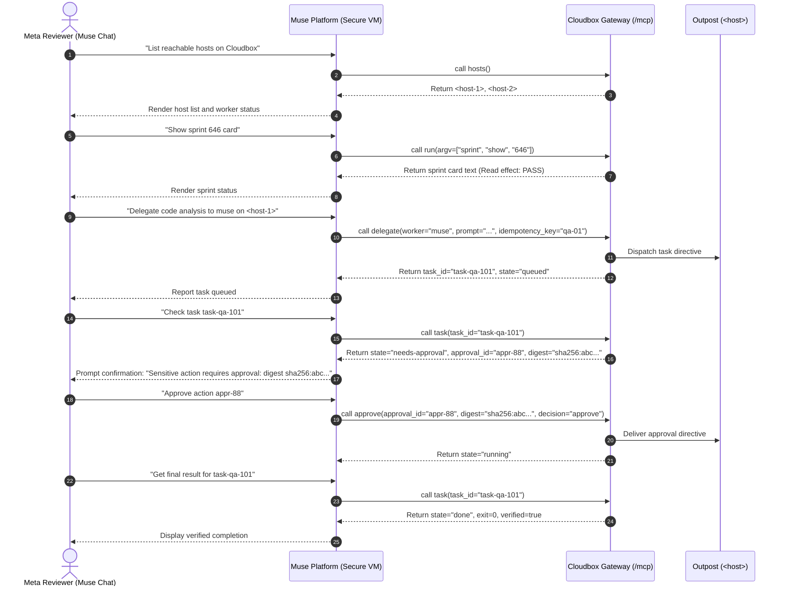

# Muse Connector Platform Submission Pack & Meta AI Integration Specification

Sprint: #646  
Spec: `docs/vendor-chat-gateway-mvp.md` (Clients in the MVP, Open live checks)  
Status: Reference Specification & Submission Pack (C1 delivery)

---

## 1. Executive Summary & Review Scope

This submission pack documents the integration of the Cloudbox Remote MCP Gateway into the **Muse Connector Platform** (`platform.muse.ai`, `dev.meta.ai/products/connectors`) for public directory listing, submitted per the vendor's current connector settings.

### Target Surfaces
1. **`muse.ai` Web Chatbox**: Operates inside each user's dedicated, sandboxed **Muse Secure VM** (isolated Linux environment + browser).
2. **Muse Mobile Apps**: Official Muse iOS and Android mobile clients.
3. **Muse Personal Agent in WhatsApp**: Reaches the gateway through the approved directory connector with **zero custom channel code**.

### 3-Stage Meta Review Process
Meta enforces a three-stage review ladder before directory publication:
1. **Stage 1: Risk & Compliance Assessment**: Privacy policy, data minimization, security posture, and OAuth implementation review.
2. **Stage 2: Per-Tool Functional Review**: Inspection of tool schemas, side effects, idempotent execution, and effect classifications.
3. **Stage 3: End-to-End QA**: Meta review team exercises the connector against a dedicated staging environment using the provided test plan.

> [!NOTE]
> Review timing is entirely Meta-controlled. Sprint and milestone deliverables complete upon submission and verification against the staging fake; directory publication dates are contingent on Meta review passes.

---

## 2. Tool Classification Derived from Bashy Effects

The Muse Connector Platform requires all tools to be categorized into one of three distinct safety tiers:
- **`Read`**: Inspection without state modification. Can execute on-request without prompting if allowed by the user's permission preferences.
- **`Write`**: State-modifying operations with standard operational impact. Audited in task logs.
- **`Sensitive-write`**: High-impact or destructive operations. **Mandatory Meta Requirement**: Must prompt for user confirmation on **EVERY** invocation (no "Always allow" option is permitted).

The Cloudbox gateway maps its seven text-first tools to these tiers using the underlying Bashy effect policies (`yoke/mcp/direct.go`):

| Tool | Muse Safety Tier | Bashy Effect | Side Effects & Safety Governance |
|---|---|---|---|
| **`hosts`** | **Read** | `read` | **None.** Queries reachable outposts, active worker runtimes, and credential health. Read-only; runs without confirmation. |
| **`task`** | **Read** | `read` | **None.** Polls task status, event tail, execution logs, and verified output. Read-only; runs without confirmation. |
| **`run`** | **Dynamic** *(Read / Write / Sensitive-write)* | *Verb-dependent* | Effect-gated by the requested bashy verb: • **Read**: verbs with `read` effect (e.g. `sprint show`, `todo list`, `status`). Executes immediately without prompts. • **Write**: standard write verbs (e.g. creating notes, non-destructive file updates). Audited in task event stream. • **Sensitive-write**: verbs with `destroy`, `spend`, `cred`, or `priv` effects (e.g. deleting files, billable cloud provisioning, credential modifications, privilege elevation, software shaping patch activation). Triggers a digest-bound approval prompt (`state: needs-approval`). |
| **`delegate`** | **Write** | `write` | **Task Allocation.** Dispatches an autonomous worker (`claude`, `codex`, `agy`, `muse`) to a specified outpost. Protected against double execution via caller-supplied `idempotency_key`. |
| **`reply`** | **Write** | `write` | **Task Interaction.** Sends steering input or clarification text to a waiting or suspended task. |
| **`cancel`** | **Write** | `write` | **Task Abort.** Halts an active task on an outpost and records the cancellation reason. |
| **`approve`** | **Sensitive-write** | `priv` / `write` | **Gated Action Settlement.** Authorizes or denies a pending gated action. **Requires user confirmation on EVERY invocation.** Binds cryptographically to the action's `digest`. Fails closed if the digest mismatches or the session expires. |

---

## 3. Dedicated Reviewer Test Account Plan

Meta QA engineers require a dedicated, reproducible test environment to validate the connector without impacting production infrastructure.

### Review Environment Infrastructure
- **Venue**: Cloudbox Staging Venue backed by `yoke/pkg/fleet/cloudboxfake` (`https://<cloudbox-host>/mcp`).
- **Reviewer Profile**:
  - **Account Name**: `meta-reviewer-qa`
  - **Opaque Profile ID**: `usr-meta-qa-88301`
  - **Role**: Operator with access to staging outposts.
- **Seeded Staging Outposts**:
  - `<host-1>`: Linux x86_64 host with simulated `claude`, `codex`, `agy`, and `muse` workers in healthy state (`ok`).
  - `<host-2>`: Darwin arm64 host with workers in varied states (`missing`, `expired`, `plan-limit`, `offline`) to verify honest state reporting.

### Step-by-Step QA Verification Script

#### Test Execution Steps:
1. **Discovery & Read-Only Checks**:
   - Prompt: `"List my hosts on Cloudbox Gateway."`
   - Expectation: `hosts` returns `<host-1>` and `<host-2>`. No permission dialog prompted.
   - Prompt: `"Run sprint show 646."`
   - Expectation: `run` executes immediately with exit 0 and verified content.
2. **Idempotent Delegation**:
   - Prompt: `"Delegate a test task to muse on <host-1>."`
   - Expectation: `delegate` returns `task_id`. Re-sending the identical prompt returns the existing `task_id` without creating duplicate tasks.
3. **Sensitive-Write Approval Enforcement**:
   - Prompt task to trigger an action with `destroy` or `spend` effect.
   - Expectation: `task` status transitions to `needs-approval`. Muse displays an approval prompt displaying the cryptographic digest.
   - Expectation: Rejection of mismatched digest or denial closes the task without execution. Correct approval resumes task execution.
4. **Task Steering & Cancellation**:
   - Prompt: `"Reply to task <id> with 'use release v1'."`
   - Expectation: `reply` appends steering directive.
   - Prompt: `"Cancel task <id>."`
   - Expectation: `cancel` aborts task execution and marks status `cancelled`.

---

## 4. Data Terms & Processing Questionnaire

This section provides the required disclosures for Meta's Data Processing and Developer Terms:

### 1. Data Minimization
- The connector only processes data explicitly required to fulfill tool execution:
  - Command arguments (`argv`), worker names, prompt strings, approval IDs, and cryptographic digests.
- The gateway does not perform bulk data extraction, file system trawling, or persistent storage of user conversational text beyond the active task lifecycle.

### 2. Prohibition on Model Training & Secondary Use
- **No Training**: Data transferred through the Cloudbox Remote MCP Gateway is strictly excluded from being used for foundation model training, fine-tuning, or algorithmic development.
- **No Commercial Resale**: User data, code, and execution artifacts are never sold, licensed, or shared with third parties.

### 3. Outpost Contributor Mode Pinned OFF
- For outposts executing delegated tasks with the **Muse Code CLI** under a Meta subscription:
  - Meta subscriptions default Contributor mode to ON.
  - **Enforced Security Policy**: All Cloudbox outpost worker adapters explicitly pin Contributor mode to **OFF** (`--contributor-mode off` or `MUSE_CONTRIBUTOR_MODE=off`).
  - Outpost telemetry probes continually verify that Contributor mode remains disabled, preventing user code and prompts from being ingested by Meta training pipelines.

### 4. Retention & Deletion Policy
- **Active Task Data**: Stored in volatile and ephemeral task queues during execution.
- **Audit Logs**: Retained for a maximum 30-day operational audit window, after which task logs and event streams are automatically purged.
- **User Account Deletion**: An account deletion request from the user or administrator triggers immediate cryptographic erasure of all associated OAuth tokens, task records, and profile associations.

### 5. Security & Incident Response
- **In Transit**: Enforced TLS 1.3 / HTTPS encryption for all external and internal gateway endpoints.
- **At Rest**: Opaque tokens and configuration secrets are encrypted using AES-256-GCM.
- **Incident Reporting**: Cloudbox maintains an incident response protocol committed to notifying Meta and affected users within 72 hours of any confirmed security compromise.

---

## 5. Channel Architecture Decision: WhatsApp Integration

Sprint 645 evaluated two architectural paths for delivering mobile chat capabilities via Meta messaging surfaces:

- **Option (a): Muse Personal Agent in WhatsApp (Recommended & Implemented)**
  - Reaches the Cloudbox gateway via the approved Muse Connector Platform directory listing.
  - **Zero custom messaging code**: Uses Meta's existing Muse-in-WhatsApp integration.
  - User interacts with the Muse agent in WhatsApp, which calls the directory connector.
- **Option (b): Stack-Owned WhatsApp Business API (Deferred)**
  - Requires registering a dedicated business phone number on Meta Business Manager, Cloud API integration, and webhook server maintenance.
  - Substantial policy, billing, and template approval overhead.

**Decision**: Option (a) is selected as the canonical path. Option (b) is deferred as an optional standalone follow-up only if Meta-independent mobile messaging is explicitly mandated.

---

## 6. Open Live Checks (Meta)

The following live checks moved from the MVP spec require explicit operator authorization before execution:

| Check ID | Description | Target Surface | Test Condition | Status |
|---|---|---|---|---|
| `META-LC-01` | **Token Lifetimes & Callback URLs** | Muse Connector Platform | Confirm exact access/refresh token expiration limits and callback URI validation patterns in the live platform.muse.ai portal. | Pending Operator Authorization |
| `META-LC-02` | **Connector Review Turnaround SLA** | Meta Review Pipeline | Benchmark turnaround duration across Stages 1, 2, and 3 during staging submission. | Pending Operator Authorization |
| `META-LC-03` | **Contributor Mode Headless Persistence** | Outpost Muse Code Worker | Verify that `--contributor-mode off` persists across headless worker process restarts and CLI auto-updates. | Pending Operator Authorization |
| `META-LC-04` | **Muse Portal Connector Submission Flow** | `platform.muse.ai` Portal | Verify current submission UI flow and form fields per the vendor's current connector settings. | Pending Operator Authorization |
